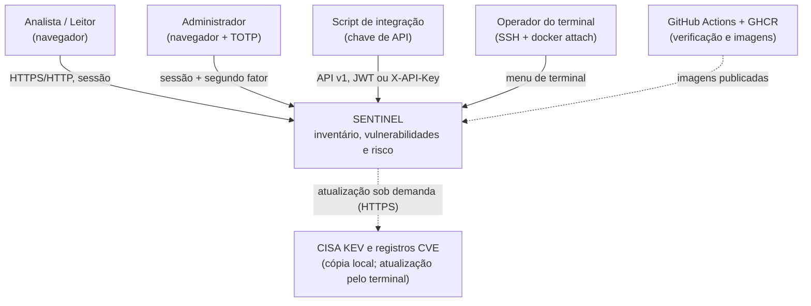
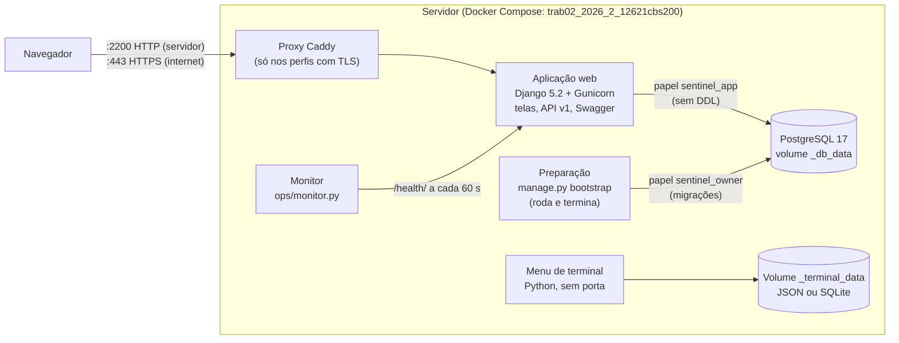

# Arquitetura da solução

Card S5_18 (projeto integrador). Descreve o SENTINEL como ele está e o que
vem depois.

## Requisitos

### Funcionais

| # | Requisito |
| --- | --- |
| RF1 | Cadastrar, consultar, alterar e excluir equipamentos, com ficha técnica |
| RF2 | Manter um catálogo de vulnerabilidades (CVE, CWE, nota e vetor CVSS) e vinculá-las aos equipamentos com a situação do tratamento |
| RF3 | Registrar dependências entre equipamentos com a fração de risco herdada |
| RF4 | Calcular o risco próprio e o efetivo (sistema linear), recusando sistema singular ou mal condicionado |
| RF5 | Montar o plano de correção: o que reduz mais o risco total |
| RF6 | Consultar o catálogo CISA KEV sem internet e cadastrar uma CVE em um clique |
| RF7 | Importar e exportar o inventário no JSON do programa de terminal |
| RF8 | Auditar entradas, recusas, alterações e emissão de tokens |
| RF9 | Oferecer API REST versionada para integração |

### Não funcionais

| # | Requisito | Como se mede |
| --- | --- | --- |
| RNF1 | Segurança: OWASP Top 10, menor privilégio, segredos fora do código | [OWASP-TOP10.md](OWASP-TOP10.md); bandit e pip-audit no CI |
| RNF2 | Disponibilidade de 24 horas no servidor, com reinício automático | `ops/servidor/verificar.sh` e o log do monitor |
| RNF3 | Integridade: nenhuma gravação pela metade nem edição perdida | Transações, versões com `If-Match`, testes |
| RNF4 | Desempenho: listagens sem N+1, resposta < 1 s com 76 ativos | `test_sqli_e_consultas.py`; `academic/benchmark.py` |
| RNF5 | Acessibilidade WCAG 2.1 AA | [web/ACESSIBILIDADE.md](web/ACESSIBILIDADE.md) |
| RNF6 | Reprodutibilidade: subir com um comando, mesmo resultado no CI | `subir.sh`; job `container` |
| RNF7 | Manutenibilidade: domínio tipado, cobertura ≥ 80% | mypy; `pytest --cov-fail-under=80` |
| RNF8 | Isolamento no servidor compartilhado (S5_20) | Nomes, porta única e limites; `test_nomenclatura.py` |

## C4: contexto

## C4: containers

Dentro da aplicação web, as camadas (detalhe em
[web/IMPLEMENTACAO.md](web/IMPLEMENTACAO.md)): views e `api_v1` (HTTP) →
`services` (gravação, transação, auditoria) e `analysis` (leitura) →
`repository` (monta o `Inventario` do domínio) → domínio (`equipamentos`,
`inventario`, `risco`), o mesmo do terminal.

## Decisões de arquitetura (ADR)

### ADR-001: um domínio, duas interfaces

- **Contexto**: o Trabalho 1 era um programa de terminal; a Sprint 4 pediu a
  versão web. Reescrever as regras em Django duplicaria a lógica do risco.
- **Decisão**: as classes do domínio (`Equipamento`, `Inventario`,
  `ModeloRisco`) ficam sem dependência de tela, arquivo ou banco; a web
  remonta esses objetos a partir do PostgreSQL (`inventory/repository.py`), e
  o terminal a partir do JSON ou do banco SQLAlchemy.
- **Consequências**: a regra do risco existe uma vez e é testada uma vez;
  importar e exportar entre as duas é trivial. Custo: a web converte modelo
  Django ↔ objeto do domínio a cada análise.

### ADR-002: PostgreSQL na web, JSON (ou SQLAlchemy) no terminal

- **Contexto**: o enunciado aceita "JSON formado por um array de objetos (ou
  banco SQL)". A web tem usuários simultâneos.
- **Decisão**: a web usa PostgreSQL com transações, travas e restrições; o
  terminal continua no JSON (o formato do enunciado), com o banco relacional
  como opção por `INVENTARIO_BANCO`.
- **Consequências**: concorrência e integridade de verdade na web; o terminal
  continua simples. Duas camadas de persistência para manter, ambas atrás de
  repositórios.

### ADR-003: API v1 contract-first, sem cookie

- **Contexto**: a API antiga usava a sessão das telas e o token CSRF, ruim para
  scripts; o S5_03/S5_04 pede versionamento, Problem Details e OpenAPI.
- **Decisão**: `/api/v1/` nova, escrita a partir de um `openapi.yaml` feito à
  mão, autenticada por JWT de 15 minutos (pessoas) ou chave de API em hash
  (scripts), sem cookie e por isso sem CSRF; concorrência otimista com
  `ETag`/`If-Match`.
- **Consequências**: o contrato é testado pelo Schemathesis no CI; duas APIs
  convivem até as telas migrarem (dívida D10). JWT não se revoga antes de
  vencer (dívida D6).

### ADR-004: nomes e porta da matrícula; HTTP no servidor da disciplina

- **Contexto**: servidor compartilhado pela turma, uma porta por aluno
  (2000 + 200), sem domínio.
- **Decisão**: todo recurso com o prefixo `trab02_2026_2_12621cbs200`; só a
  aplicação publica a 2200; HTTP com `DJANGO_HTTPS=0` explícito; o perfil com
  TLS fica pronto (`compose.tls.yaml`, `compose.web.yaml`).
- **Consequências**: nenhum conflito com colegas; o tráfego da rede interna
  não é cifrado (achado D4, aceito com prazo).

### ADR-005: Swagger UI servido pela própria aplicação

- **Contexto**: a CSP é `'self'`; um CDN quebraria a política e criaria
  dependência externa (cadeia de suprimentos).
- **Decisão**: os arquivos do Swagger UI ficam no repositório
  (`inventory/static/inventory/vendor/swagger-ui/`, com a licença), e a página
  usa um script próprio, sem `unsafe-inline`.
- **Consequências**: atualizar o Swagger UI é trocar os arquivos à mão.

## Modelo de ameaças (STRIDE)

Fluxos principais: (1) entrada nas telas, (2) API v1, (3) importação do JSON,
(4) administração no servidor, (5) atualização da base CVE.

| Fluxo | STRIDE | Ameaça | Mitigação (card) |
| --- | --- | --- | --- |
| 1 Entrada | **S**poofing | Força bruta ou senha vazada | Bloqueio após 5 erros, política NIST, Argon2id, TOTP do administrador (S5_08) |
| 1 Entrada | **T**ampering | CSRF: outro site envia formulário com a sessão da vítima | Token CSRF, `SameSite=Lax` (S5_10) |
| 1 Entrada | **I**nformation disclosure | Roubo do cookie por XSS ou na rede | `HttpOnly`, CSP, escape dos templates; `Secure` + HSTS com TLS (S5_10, S5_11) |
| 2 API | **S**poofing | Token forjado ou com `alg: none` | HS256 com algoritmo fixo, `iss`/`aud`/`exp` obrigatórios (S5_09) |
| 2 API | **E**levation of privilege | Leitor alterando por id na URL (IDOR) | Permissão por rota, papel no token; teste de IDOR (S5_10) |
| 2 API | **T**ampering | Edição concorrente apagando a outra | `If-Match`, 409/428 (S5_03) |
| 2 API | **D**enial of service | Pedido gigante ou varredura | Corpo até 2 MB, paginação até 100; limite de taxa pendente (D7) |
| 2 API | **I**nformation disclosure | SQL injection nos filtros | ORM com parâmetros; testes com as cargas (S5_07) |
| 3 Importação | **T**ampering | JSON adulterado (chave repetida, NaN, ids trocados) | Validação completa do domínio, base vazia, transação, conferência de ida e volta |
| 3 Importação | **D**enial of service | Arquivo enorme ou aninhado demais | 2 MB, recusa de recursão |
| 4 Servidor | **E**levation of privilege | Fuga do container | Usuário sem privilégio, `cap_drop: ALL`, `no-new-privileges`, `read_only` (S5_15) |
| 4 Servidor | **D**enial of service | Container consumindo o servidor da turma | `mem_limit`, `pids_limit`, rotação de log (S5_15) |
| 4 Servidor | **R**epudiation | Alteração sem autor | Auditoria com autor, data e o que mudou; logs do Gunicorn |
| 4 Servidor | **I**nformation disclosure | Segredo no Git ou na imagem | `.env` gerado no servidor (`umask 077`), fora do Git e da imagem |
| 5 Base CVE | **T**ampering | Download adulterado ou por HTTP | Só HTTPS (`abrir_url`), conferência antes de substituir, cópia anterior mantida |
| CI/CD | **T**ampering | Ação de CI ou dependência trocada | Ações por SHA, pip-audit, Trivy, proveniência das imagens (S5_14) |

## Backlog das próximas etapas

| # | História | Critérios de aceitação | Prioridade |
| --- | --- | --- | --- |
| B1 | Como **administrador**, quero entrar só com senha **e** código do aplicativo no servidor, para que a senha vazada não baste | `DJANGO_REQUIRE_MFA=1` no servidor; entrada sem código recusada; token da API pede `otp`; teste automatizado | Alta |
| B2 | Como **analista**, quero acessar por HTTPS, para que a senha não trafegue aberta | Certificado aceito pelo navegador da UFU (CA interna) ou porta 443 liberada; HSTS; `openssl s_client` mostra TLS 1.3 | Alta |
| B3 | Como **integrador**, quero revogar um token roubado na hora | `POST /api/v1/auth/revoke`; token revogado → 401 antes de vencer; teste | Média |
| B4 | Como **responsável pelo servidor**, quero que a API limite pedidos por minuto | Acima do limite → 429 com `Retry-After`; teste | Média |
| B5 | Como **gestor**, quero ser avisado de bloqueios e recusas em sequência | Alerta (e-mail ou syslog) acima de N recusas em 10 min | Baixa |
| B6 | Como **desenvolvedor**, quero as telas usando a API v1 | Telas sem `/api/<tipo>/`; API antiga removida na v2.0; testes de tela passam | Baixa |
| B7 | Como **desenvolvedor**, quero `main.py` dividido por assunto | Nenhuma classe acima de 400 linhas; `testes.py` passa sem mudança | Baixa |
| B8 | Como **avaliador**, quero a aplicação publicada na nuvem por um período | URL HTTPS, logs visíveis, recursos encerrados depois ([NUVEM.md](NUVEM.md)) | Média |
