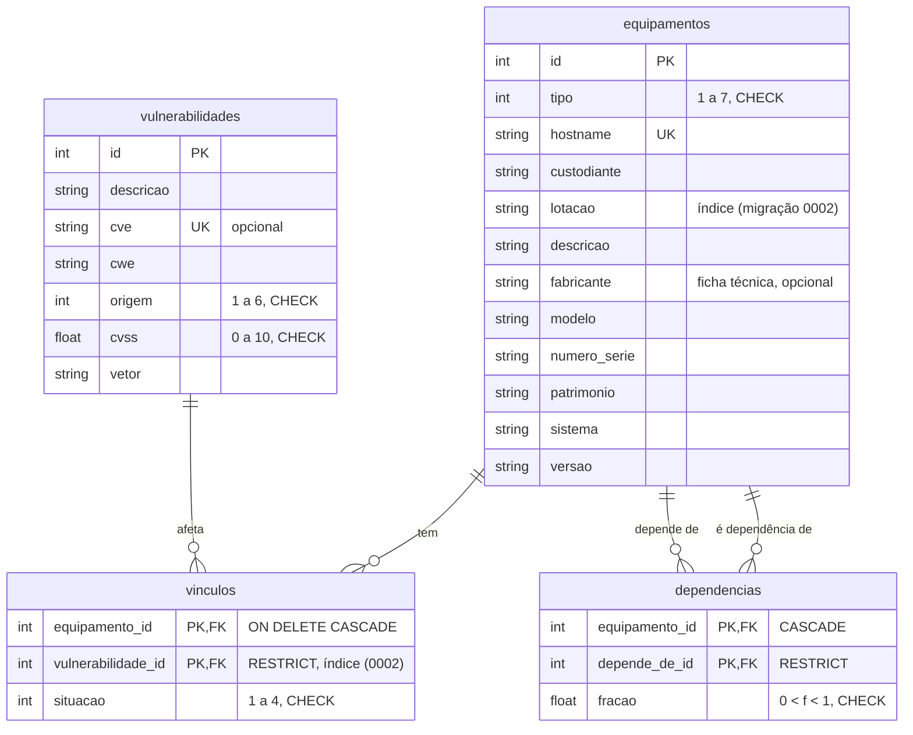

# Mapeamento objeto-relacional e repositório SQLAlchemy

Cards S5_05 e S5_06. Há dois ORMs no projeto, cada um numa interface:

| Interface | ORM | Banco | Migrações |
| --- | --- | --- | --- |
| Web | Django ORM (`inventory/models.py`) | PostgreSQL | `inventory/migrations/` (`manage.py migrate`) |
| Terminal | SQLAlchemy 2 (`repositorio_sql.py`) | SQLite ou PostgreSQL, pela URL | Alembic (`migracoes_sql/`) |

O domínio (`Equipamento`, `Vulnerabilidade`, `Inventario`, `ModeloRisco`) é o
mesmo nos dois e não sabe de banco.

## O descompasso objeto-relacional

| No objeto | Na tabela | Como foi resolvido |
| --- | --- | --- |
| Herança: `Equipamento` abstrata e sete subclasses | Tabela não tem herança | Tabela única com discriminador (`tipo`) |
| Identidade: o mesmo objeto `Vulnerabilidade` em vários equipamentos | Chave primária | `id` do domínio vira a chave (`autoincrement=False`): o arquivo JSON, o banco e as telas usam o mesmo número |
| Dicionário `equipamento.vulnerabilidades` (id → situação) | Relação N:N com atributo | Tabela associativa `vinculos` com a coluna `situacao` |
| Dicionário `equipamento.dependencias` (id → fração) | Auto-relacionamento N:N com atributo | Tabela `dependencias` (`equipamento_id`, `depende_de_id`, `fracao`) |
| Composição: `FichaTecnica` dentro do equipamento | Colunas | As seis colunas da ficha na própria tabela (1:1 sem tabela à parte) |
| Regras (hostname único, soma das frações < 1) | Restrições | As do domínio continuam; o banco repete o que consegue (UNIQUE, CHECK, FK) |

## Diagrama (terminal, SQLAlchemy)



A versão web (Django) tem o mesmo desenho, mais as tabelas de auditoria,
histórico de tratamento, chaves de API e contas: veja
[web/MODELO-DADOS.md](web/MODELO-DADOS.md).

## Estratégia de herança: tabela única

As três opções para `Equipamento` → `Servidor`, `Roteador`, ...:

| Estratégia | Como seria | Por que sim ou não |
| --- | --- | --- |
| **Tabela única** (escolhida) | Uma tabela `equipamentos` com a coluna `tipo` | As subclasses não têm atributo próprio: diferem só no comportamento (o fator de exposição). Uma consulta pega todos, sem junção nem coluna vazia |
| Tabela por classe concreta | `servidores`, `roteadores`, ... | Sete tabelas iguais; "todos os equipamentos" vira `UNION` de sete; hostname único entre tabelas não tem restrição do banco |
| Tabela por subclasse (junção) | `equipamentos` + uma tabela por tipo com o que é só dele | Cada leitura faz junção para tabelas vazias de colunas |

A coluna `tipo` guarda o valor do `Enum` `TipoEquipamento`, e
`Equipamento.de_dict()` escolhe a subclasse por ele: é o discriminador.
O CHECK da faixa é montado a partir do próprio `Enum`
(`_faixa("tipo", TipoEquipamento)`), então um tipo novo não esquece o banco.

## Repositório: trocar JSON por banco sem mexer no serviço

`main.py` (o serviço) só chama `carregar()` e `salvar()`. Dois repositórios
cumprem essa interface:

| Classe | Onde | Quando |
| --- | --- | --- |
| `ArquivoInventario` | `armazenamento.py` | Padrão: arquivo JSON |
| `BancoInventario` | `repositorio_sql.py` | Com a variável `INVENTARIO_BANCO` (URL do SQLAlchemy) |

`armazenamento.abrir_repositorio()` escolhe pela variável; `main.py` mudou uma
linha (`Aplicacao(abrir_repositorio())`) e nenhuma regra. O healthcheck do
`Dockerfile` usa a mesma função, então confere o repositório que estiver em uso.

`BancoInventario.carregar()` monta do banco o mesmo conteúdo do arquivo e o
passa por `Inventario.de_dict()`, que confere tudo: o banco é uma segunda
barreira, não a única. Uma alteração feita por fora que o banco aceite mas o
domínio não (um hostname com espaço) vira `BaseInvalidaError`, como um arquivo
adulterado.

### Sessão, unidade de trabalho e transação

`salvar()` abre **uma** `Session` com `sessao.begin()`: apaga e regrava as
quatro tabelas na mesma transação. Ou tudo é gravado, ou nada muda (o teste
`test_gravacao_com_erro_nao_muda_nada` força um hostname repetido no meio e
confere que a base anterior continua inteira). É o mesmo efeito da gravação
atômica do arquivo (temporário + `os.replace`). A `Session` é a unidade de
trabalho: junta as inserções e as manda no `flush`, na ordem das chaves
estrangeiras.

### Mapeamento declarativo

```python
class VinculoSQL(Base):
    __tablename__ = "vinculos"
    equipamento_id: Mapped[int] = mapped_column(
        ForeignKey("equipamentos.id", ondelete="CASCADE"), primary_key=True)
    vulnerabilidade_id: Mapped[int] = mapped_column(
        ForeignKey("vulnerabilidades.id", ondelete="RESTRICT"),
        primary_key=True, index=True)
    situacao: Mapped[int] = mapped_column(Integer)
    equipamento: Mapped[EquipamentoSQL] = relationship(back_populates="vinculos")
```

`EquipamentoSQL.vinculos` e `dependencias` são `relationship()` com
`cascade="all, delete-orphan"`; as consultas usam `select()`.

## Consulta com junção: ORM e SQL escrito à mão

"Quais equipamentos têm a vulnerabilidade 7, com a situação":

```python
select(EquipamentoSQL.hostname, VinculoSQL.situacao)
    .join(VinculoSQL, VinculoSQL.equipamento_id == EquipamentoSQL.id)
    .where(VinculoSQL.vulnerabilidade_id == 7)
    .order_by(EquipamentoSQL.hostname)
```

gera (com `create_engine(url, echo=True)`):

```sql
SELECT equipamentos.hostname, vinculos.situacao
FROM equipamentos JOIN vinculos ON vinculos.equipamento_id = equipamentos.id
WHERE vinculos.vulnerabilidade_id = ?
ORDER BY equipamentos.hostname
```

O mesmo que o SQL escrito à mão em [web/consultas.sql](web/consultas.sql)
(Sprint 4), com uma diferença: o `7` vai como parâmetro (`?`), nunca colado no
texto. O índice `ix_vinculos_vulnerabilidade_id` (migração 0002) existe para
esta consulta: a chave primária de `vinculos` começa pelo equipamento.

## Migrações (Alembic)

| Revisão | O que faz |
| --- | --- |
| `0001_esquema_inicial` | Cria as quatro tabelas, com chaves, UNIQUE e CHECK |
| `0002_indices_de_busca` | Primeira alteração de esquema: índices de `lotacao` e de `vinculos.vulnerabilidade_id` |

O repositório aplica as que faltam na primeira leitura
(`command.upgrade(config, "head")`); o esquema nunca vem de `create_all()`.
Os testes conferem que a migração cria exatamente o que o modelo descreve
(`compare_metadata` sem diferenças) e que um banco na 0001 sobe para a 0002
sem perder dados.

```bash
# Linha de comando (Linux; no PowerShell, defina a variável com $env:INVENTARIO_BANCO = "...")
export INVENTARIO_BANCO=sqlite:///dados/inventario.db
alembic -c migracoes_sql/alembic.ini upgrade head
alembic -c migracoes_sql/alembic.ini history
alembic -c migracoes_sql/alembic.ini downgrade 0001
alembic -c migracoes_sql/alembic.ini current
```

No SQLite, as chaves estrangeiras vêm desligadas: o repositório liga
`PRAGMA foreign_keys = ON` em cada conexão.

## Testes com SQLite em memória

`testes.py`, classe `TesteDoRepositorioSQL` (e o autoteste
`python repositorio_sql.py`): banco novo vazio, esquema pela migração,
migração igual ao modelo, ida e volta igual ao JSON (com a vulnerabilidade
compartilhada guardada uma vez só), regravação, transação desfeita, CHECK e
FK barrando SQL feito por fora, conteúdo fora das regras recusado, 0001 → 0002,
variável de ambiente escolhendo o repositório e a senha da URL fora das
mensagens. Usam `create_engine("sqlite://", poolclass=StaticPool)`: nenhum
arquivo é criado.

## N+1: demonstração e correção

`tests_web/test_sqli_e_consultas.py`:

```python
# Ingênuo: 1 consulta para os achados + 1 por achado para o equipamento
[f.asset.hostname for f in Finding.objects.all()]                     # 1 + N
# Carregamento antecipado: uma consulta só, com JOIN
[f.asset.hostname for f in Finding.objects.select_related("asset")]   # 1
```

Com a base de exemplo (N > 50 tratamentos), o teste conta `1 + N` e `1`. Depois
o mesmo teste mede cada listagem da API v1 e cada tela (visão geral, mapa,
análise, relatórios, grafo, risco) com a base de 3 equipamentos e com a de 76:
o número de consultas tem de ser **igual** nas duas. Hoje é. No SQLAlchemy, o
equivalente é `selectinload()`/`joinedload()`; o repositório do terminal lê o
catálogo de vulnerabilidades uma vez e monta o resto em memória, sem consulta
por equipamento.

## Quando SQL direto é melhor que o ORM

- Relatórios com agregação (`GROUP BY`, `HAVING`, `CASE`): o relatório por
  setor é calculado no banco ([web/consultas.sql](web/consultas.sql), Sprint 4).
- Funções de janela (`RANK() OVER`) e consultas recursivas (`WITH RECURSIVE`),
  que o ORM expressa mal; o alcance das dependências, por exemplo, poderia ser
  uma consulta recursiva (hoje é a busca em largura em Python).
- Carga em massa (`COPY` do PostgreSQL) e manutenção (`VACUUM`, índices).
- Ajuste de desempenho com `EXPLAIN ANALYZE` e dicas próprias do banco.
- Migrações de dados delicadas, revisadas linha a linha.

Mesmo aí, o valor do usuário vai como parâmetro; ver
[LAB-SQL-INJECTION.md](LAB-SQL-INJECTION.md).
