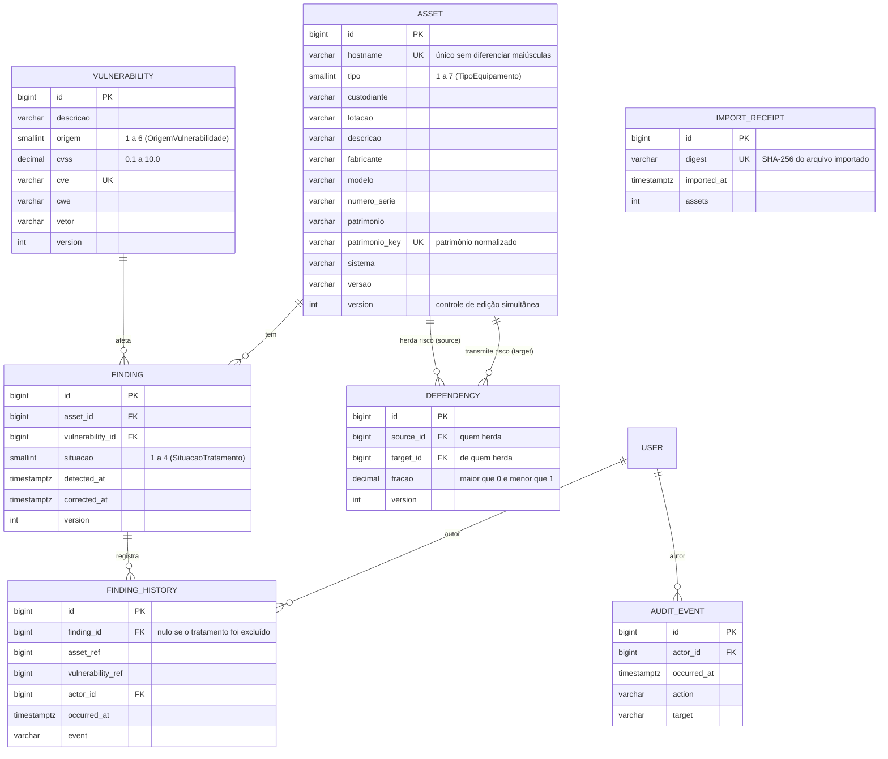

# Modelo de dados

O inventário fica em PostgreSQL. O script de criação está em [esquema.sql](esquema.sql) e as consultas de estudo, em [consultas.sql](consultas.sql). As classes do domínio (`Equipamento` e suas filhas, `Vulnerabilidade`, `Inventario`, `ModeloRisco`) continuam nos módulos Python originais: a cada leitura, `inventory/repository.py` monta esses objetos a partir das tabelas.

## Diagrama entidade-relacionamento

## Como o modelo de risco usa as tabelas

| Elemento do modelo | De onde vem |
|---|---|
| Matriz de incidência M (equipamento × vulnerabilidade) | Tabela `finding`: M vale 1 quando existe o vínculo e a situação não é Corrigida |
| Vetor de severidade v | Coluna `cvss` de `vulnerability` |
| Fator de exposição F | Método polimórfico de cada classe de equipamento, escolhida pela coluna `tipo` |
| Matriz de dependências A | Tabela `dependency`: A[source][target] = `fracao` |

## Regras garantidas pelo próprio banco

- `finding`: um par (ativo, vulnerabilidade) só pode existir uma vez; data de correção só com situação Corrigida e nunca anterior à detecção.
- `dependency`: um ativo não depende de si mesmo; a fração fica entre 0 e 1; um gatilho recusa a gravação quando a soma das frações de um ativo chegaria a 1 ou mais. Essa regra mantém I − A estritamente diagonal dominante e, portanto, invertível.
- Excluir um ativo apaga seus tratamentos e dependências (`ON DELETE CASCADE`); o catálogo de vulnerabilidades e o histórico permanecem.
- A aplicação acessa o banco com um papel que só lê e grava dados; criar e alterar tabelas cabe ao papel proprietário, usado apenas nas migrações.
